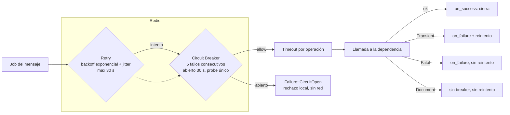
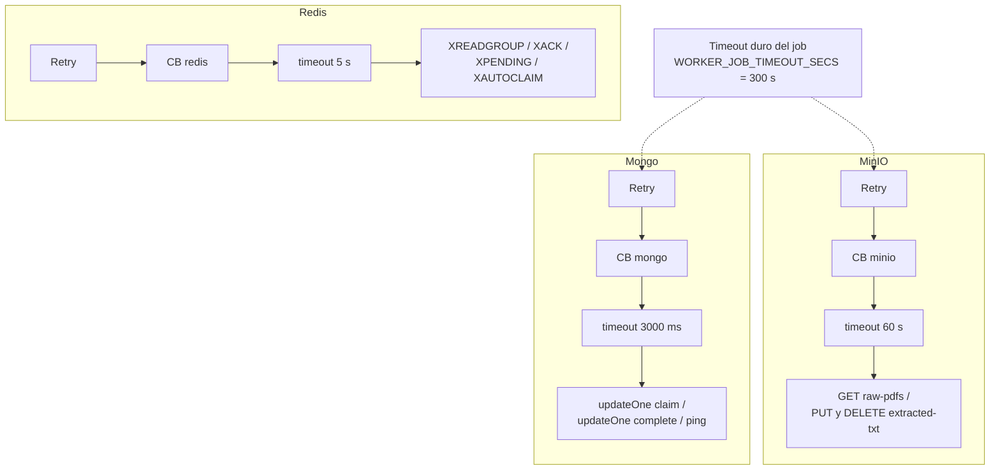

# ADR-0007 — Composición de la resiliencia por dependencia

- **Estado:** aceptado
- **Fecha:** 2026-10-28
- **Tareas:** `S5-P3-01` (deriva de `S2-P3-04`, `S2-P3-05`, `S2-P3-06`)
- **Ámbito:** Extraction Worker (Rust)

## Contexto

El worker depende de tres sistemas externos en cada trabajo: **Redis**
(streams, PEL, DLQ), **MinIO** (descarga del PDF y subida del `.txt`) y
**Mongo** (transición de estado `PROCESSING → COMPLETED`).

Cada dependencia falla de forma distinta y a distinta velocidad. Un único
timeout global o un único circuit breaker compartido acoplaría las
dependencias: MinIO lento abriría el breaker que protege a Redis, y un
reintento de Mongo consumiría el presupuesto de tiempo de la descarga.
La composición tiene que ser **explícita, por dependencia y en un orden
conocido**.

## Decisión

Toda llamada a una dependencia se ejecuta como:

```text
Retry → Circuit Breaker → Timeout → llamada
```

es decir, el `Retry` es la capa más externa, el breaker decide si se toca la
red y el timeout acota **cada intento individual**. Cada dependencia tiene su
**propia instancia** de breaker y su **propio timeout**.



La misma forma se repite tres veces, con parámetros distintos:



## Parámetros

| Dependencia | Retry | Circuit Breaker | Timeout por operación | Variable / constante |
|---|---|---|---|---|
| Redis | backoff exponencial + jitter, tope 30 s | 5 fallos consecutivos, abierto 30 s, probe único | 5 s | `REDIS_OP_TIMEOUT`, `WORKER_BLOCK_MS=5000` |
| MinIO | backoff exponencial + jitter, tope 30 s | 5 fallos consecutivos, abierto 30 s, probe único | 60 s | `S3_OP_TIMEOUT` |
| Mongo | backoff exponencial + jitter, tope 30 s | 5 fallos consecutivos, abierto 30 s, probe único | 3000 ms | `MONGO_TIMEOUT_MS` |

Además:

- **Timeout duro del job:** `WORKER_JOB_TIMEOUT_SECS` (300 s por defecto)
  envuelve a la extracción completa. Es la última línea de defensa ante un
  PDF hostil que no muere por los topes de páginas o de salida.
- **`XAUTOCLAIM`:** cada `WORKER_XAUTOCLAIM_INTERVAL_SECS` (30 s), con
  `min_idle_ms` mayor a 2x el timeout del job, para no robar trabajos vivos.
- **Bulkhead por instancia:** `WORKER_MAX_CONCURRENCY` (4 por defecto)
  extracciones en paralelo con `JoinSet`; el resto espera en la cola de Redis.
- **DLQ atómica:** `XADD` a la DLQ + `XACK` del original en un script Lua
  (una sola operación del servidor), para no dejar el mensaje a medias.

## Taxonomía de fallos y efecto en las capas

| Fallo | ¿Reintenta? | ¿Cuenta para el breaker? | Destino |
|---|---|---|---|
| `Transient` (red, timeout, 5xx) | Sí, con backoff | Sí | Reintento; se agota → DLQ |
| `Fatal` (auth, configuración) | No | Sí | DLQ sin reintento |
| `Document` (`PDF_CORRUPT`, `NOT_A_PDF`, topes) | No | No | DLQ / `REJECTED`, es problema del documento |
| `CircuitOpen` | No | No | Rechazo local sin tocar la red; el mensaje queda pendiente |

Regla de composición: el breaker **nunca** cuenta los fallos de documento
(reintentarlos no cambia el resultado) ni sus propios rechazos (ya hizo su
trabajo). Un `CircuitOpen` no consume presupuesto de reintento.

## Consecuencias

- **Aislamiento:** una dependencia degradada no contamina el presupuesto de
  las otras; el breaker de MinIO no afecta a Redis ni a Mongo.
- **Rechazo local:** con el breaker abierto no salen conexiones nuevas, solo
  rechazos inmediatos, lo que evita *retry storms*.
- **Costo:** más configuración por dependencia y tres breakers por proceso.
  Es deliberado: son tres fallos distintos y se observan por separado.
- **Comportamiento ante apagado:** el `CancellationToken` corta el bucle; el
  mensaje en vuelo no se `XACK`-ea y queda en la PEL para `XAUTOCLAIM`.

## Alternativas descartadas

- **Un solo breaker global:** acopla dependencias sanas a la degradada y
  convierte un problema de MinIO en una caída de todo el consumo.
- **Retry dentro del breaker:** reintenta sobre un breaker ya abierto,
  multiplicando los rechazos locales y ocultando la causa.
- **Timeout global único:** no distingue 60 s de descarga de un PING de Redis
  de 5 s; o es demasiado largo para Redis o demasiado corto para MinIO.
- **Sin breaker (solo timeouts):** cada mensaje paga el timeout completo
  contra una dependencia caída; con 1000 mensajes es una caída en cascada.

## Verificación

- `crates/worker/src/consumer/resilience.rs`: tests de la composición
  Retry/CB (probe único, conteo y no conteo por tipo de fallo).
- `crates/worker/src/objects.rs`, `document_store.rs`, `consumer/runner.rs`:
  uso de `with_retry_cb` con el breaker de cada dependencia y timeout por
  operación.
- `crates/worker/src/consumer/pipeline.rs`: timeout duro del job.
- Pendiente (`S5-P3-02`/`S5-P3-03`): test de breaker abierto sin red y prueba
  de degradación con MinIO lento.

## Referencias

- `pasos-iniciales.md` §3.4 (DoD global), §8.5 (`S5-P3-01`), §7.3
- `arquitectura.md` §7 (resiliencia y observabilidad)
- ADR-0006 (transición condicional del estado en Mongo)
- SPEC §5.4 (streams, PEL y DLQ)
